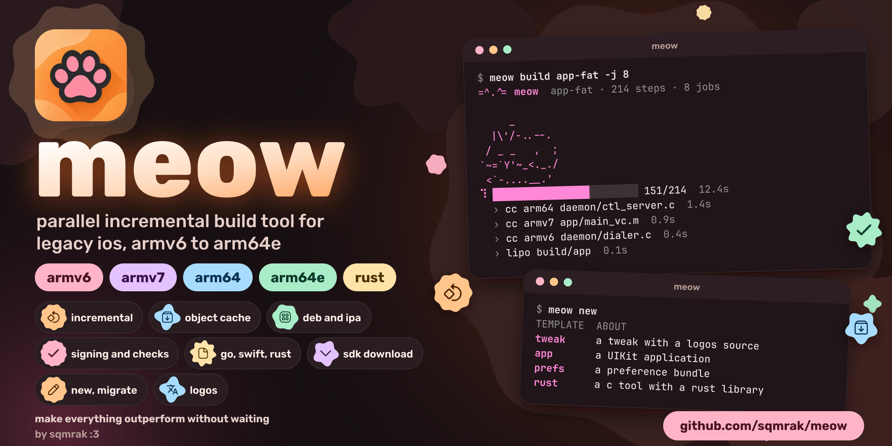

# meow

<p align="center">
  
</p>

<p align="center"><b>parallel incremental build tool for legacy ios projects, armv6 to arm64e, one rust binary, no make, no ninja</b></p>

> [!NOTE]
> meow builds with a toolchain and sdks that are already on the host (theos, or the paths you set). it does not download one.

the project makefiles of the old ios work compile every source in one clang call, run the slices one after another, clean before each release build and do not track headers. meow compiles one object per source per slice, runs the armv7 and arm64 jobs in one pool and rebuilds only what changed.

## slices

- armv6: ios 2.0 to 4.2.1, needs an sdk up to 5.1
- armv7: ios 3.0 to 10.3.3
- arm64: ios 7.0 and later
- arm64e: ios 12.0 and later
- one `meow.toml` per project, a slice is a compiler and its flags, a target picks the slices it builds

`meow ios` prints which slice runs on which release. a project is refused when `min_ios` leaves a slice no device.

## hosts

- linux
- macos
- android (termux)
- windows: deb and ipa are written by meow, modes come from the spec

see [docs/hosts.md](docs/hosts.md) for what was checked and what differs.

## features

- one object per source per slice, headers tracked through `clang -MMD`, freshness by content hash, a changed mtime with the same bytes stays fresh
- a shared object cache in `~/.cache/meow`, so a clean tree or a second checkout takes its objects from it
- link inputs that are not on the command line are tracked too: `-lname` found through `-L`, pieces of `-Wl,a,b`, `@response` files
- `lipo` of every slice of an executable or an archive, `strip`, `ldid` signing with the signature read back
- deb and ipa written by meow: gnu tar, gzip data, root ownership, fixed mtime, equal input gives equal bytes. ios before 8 cannot read xz, so only gzip is written
- release checks on a finished binary: slices, deployment target, signature, linked dylibs, undefined and required symbols
- steps for what meow does not model (dependency builds, scripts), pinned downloads, host tests with sanitizers, syntax-only compiles against an older sdk
- icons, launch images, glyphs from svg and single images made by meow itself, no pillow, rsvg or ffmpeg
- `plan` prints every command and whether it is fresh or stale and runs nothing, `why` says what made a step stale, `compdb` writes `compile_commands.json`
- `install` copies a deb to a jailbroken device and runs `dpkg -i`
- `sdk` lists the ios sdks 2.0 to 16.5 and downloads the one you name, pinned by hash or commit
- `kind = "go"` packages (arm64 and armv7), `.swift` sources and `kind = "rust"` crates (arm64 and armv7) are built and linked into products
- `new` writes a project from a template, `migrate` turns a theos project into a `meow.toml`, `plist` converts property lists
- `logos` runs the logos preprocessor on `.x` and `.xm` files, byte for byte the output of the perl one on the test corpus

## against theos

the same tree of [github.com/sqmrak/senko](https://github.com/sqmrak/senko) built two ways on one machine: the old `build_deb.sh` with theos make, and `meow build release`. both run the host tests, the go core tests, the three daemon and app slices, both dylibs, lipo, signing, the release checks and the deb. openssl, quic and mbedtls were already built for both.

| what | theos, build_deb.sh | meow |
|---|---|---|
| full build, nothing cached | 632 s | 112 s |
| clean tree, object cache warm | 632 s | 34 s |
| one function changed in the daemon | 632 s | 6.5 s |
| nothing changed | 632 s | 0.05 s |

`build_deb.sh` cleans everything before it builds, so every row is a full build for it. meow compiled everything cold, took the objects from the cache on the clean tree, rebuilt only the changed object, its link, the tests that use it, the checks and the deb after the change, and nothing on the last run.

what the numbers leave out: the old script also ran network probes of the tls roots, which meow dropped, and the deb from meow is about 0.6% larger, because the gzip meow writes is its own deflate and not gnu gzip -9. one run each, no averages.

## build

repo: https://github.com/sqmrak/meow

```bash
git clone https://github.com/sqmrak/meow
cd meow
cargo build --release
cargo test
meow --version
```

build with a plain PATH. the theos toolchain shadows the host assembler and breaks cargo linking.

## use

```bash
meow init                           # meow.toml for the c sources in src/
meow doctor                         # toolchain, sdks and host tools it found
meow plan app-fat                   # commands and what is stale, runs nothing
meow build app-fat -j 8             # build and lipo
meow build app --slice arm64        # one slice of a target
meow build                          # the names of `default` in meow.toml
meow test                           # host tests
meow why app-fat                    # why each stale step is stale
```

meow looks for `meow.toml` in the current directory and then in its parents, `-C dir` and `-f file` override that. every path in the file is relative to the directory that holds it. `build` writes under `build/`, the records live in `build/.meow`. `clean` removes only files under `build/`, the dependency caches and release archives stay.

a fat output, a step, a deb, an ipa and a verify span every slice, `--slice` cannot apply to them.

## environment

the toolchain, sdks and cache are found by `meow doctor` and can be set by hand, an environment variable of the same name wins:

`MEOW_TC MEOW_CLANG MEOW_LDID MEOW_LIPO MEOW_AR MEOW_STRIP MEOW_NM MEOW_SDK_ARMV6 MEOW_SDK_ARMV7 MEOW_SDK_ARM64 MEOW_CRT_ARMV7 MEOW_CACHE_DIR`

otherwise meow looks at `$THEOS/toolchain/<os>/iphone/bin`, the tools directory (`$MEOW_TOOLS`, or the default one that `meow setup` fills) and a PATH directory that holds clang and ldid together. `meow setup all` installs the toolchain, headers, sdks, rust, go and swift. see [docs/toolchain.md](docs/toolchain.md).

`MEOW_CACHE` moves the object cache, `MEOW_CACHE_MAX` caps it in MiB (4096), `MEOW_NO_CACHE=1` skips it.

## docs

- [config](docs/config.md): `meow.toml`, variables, include, default
- [hosts](docs/hosts.md): linux, macos, android and windows, what was checked
- [toolchain](docs/toolchain.md): slices, toolchain and sdk lookup, ios versions, armv6
- [targets](docs/targets.md): sources, link kinds, fat outputs, link inputs
- [projects](docs/projects.md): `[project]`, `[package]`, `[product.*]`
- [steps](docs/steps.md): steps, dependencies, written files, host tests, compat checks
- [packages](docs/packages.md): deb, ipa, package checks, versions, install
- [verify](docs/verify.md): strip, signing, release checks on a binary
- [pictures](docs/pictures.md): icons, launch images, glyphs, images
- [cache](docs/cache.md): freshness, the object cache, why, compdb
- [setup](docs/setup.md): `meow setup`, installs the toolchain, headers, sdks, rust, go and swift
- [sdk](docs/sdk.md): `meow sdk`, ios sdks 2.0 to 16.5 from a pinned manifest
- [swift](docs/swift.md): `.swift` sources, ios 12.2 and later
- [go](docs/go.md): go packages as c archives, arm64 and armv7
- [rust](docs/rust.md): cargo crates linked into products
- [new](docs/new.md): `meow new`, project templates
- [migrate](docs/migrate.md): `meow migrate`, a meow.toml from a theos project
- [plist](docs/plist.md): `meow plist`, xml, binary and json
- [logos](docs/logos.md): `meow logos`, the logos preprocessor and logify
- [commands](docs/commands.md): every command and option

## verified

on a real project, [github.com/sqmrak/senko](https://github.com/sqmrak/senko): `meow build release` runs the host tests, the go core tests, the dependency steps, the app, the daemon, the control tool and both injected dylibs for every slice, the packaging and the deb checks. the deb matches the one the old make build gave, file for file, except for the app (its source changed since) and the daemon, which differs only in function order: make sorts the lwip sources by locale, meow by byte. defined symbols, load commands and linked libraries of the daemon match the make build.

`cargo test` runs the host tests on linux. `cargo check --tests` passes for `x86_64-pc-windows-gnu`, `aarch64-apple-darwin`, `x86_64-apple-darwin` and `aarch64-linux-android`, but meow has not been run on those systems. nothing from meow has run on a device, `install` is tested for its arguments only.

## license

meow is under the GNU GPL version 3 with one additional term: a project that is built with meow names meow, its author and its repository in its readme. one line is enough:

```
built with meow by sqmrak, https://github.com/sqmrak/meow
```

the full text and the exact rules are in [LICENSE](LICENSE).
